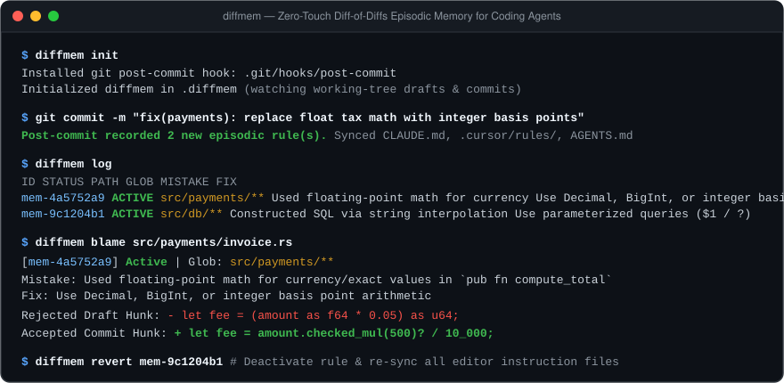

# diffmem

Correlates reverted or overwritten working-tree diffs against final git commits to build path-scoped episodic rules across coding agents.

[](https://github.com/abhinavm-web/diffmem/actions/workflows/ci.yml)
[](https://github.com/abhinavm-web/diffmem/releases)
[](LICENSE)
[](Cargo.toml)

<p align="center">
  
</p>

## Overview

Static instruction files (`CLAUDE.md`, `.cursorrules`, `AGENTS.md`) require manual upkeep, while MCP memory tools (`memory_write`) depend on the agent choosing to invoke them during a session.

`diffmem` extracts lessons passively from git activity:

- **Working-tree observation and commit hook**: `diffmem watch` captures transient working-tree diffs before reverts or overwrites, and a git `post-commit` hook correlates discarded hunks against overlapping committed hunks.
- **Path-scoped rules with recurrence tracking**: Extracts `Mistake -> Fix` rules bound to directory globs (e.g. `src/payments/**`), filters out non-overlapping unrelated edits, and increments a `SEEN` occurrence counter when an issue repeats.
- **Human review and multi-editor sync**: Inspect underlying rejected/accepted hunks with `diffmem blame`, approve or deactivate rules with `diffmem approve` / `diffmem revert`, and sync active rules into `CLAUDE.md`, `.cursor/rules/*.mdc`, and `AGENTS.md` using bounded marker blocks.

```text
  Agent Draft Diff (Reverted / Overwritten) --+
                                              +--> Diff-of-Diffs Correlator
  Final Verified `git commit` ----------------+               |
                                                              v
                                               +-----------------------------+
                                               | .diffmem/rules.json         |
                                               | [src/payments/**]           |
                                               | Mistake: f64 currency math  |
                                               | Fix: i64 integer cents      |
                                               +--------------+--------------+
                                                              |
                                          +-------------------+-------------------+
                                          v                   v                   v
                                      CLAUDE.md     .cursor/rules/*.mdc       AGENTS.md
```

## Installation

Install prebuilt binaries, download an archive from [GitHub Releases](https://github.com/abhinavm-web/diffmem/releases/latest), or build from source:

```bash
# macOS (Apple Silicon) and Linux (x86_64)
curl -fsSL https://raw.githubusercontent.com/abhinavm-web/diffmem/main/install.sh | sh
```

```powershell
# Windows (PowerShell)
irm https://raw.githubusercontent.com/abhinavm-web/diffmem/main/install.ps1 | iex
```

From source:

```bash
git clone https://github.com/abhinavm-web/diffmem.git
cd diffmem
cargo run --example showcase
cargo install --path .
```

## Usage

### Initialize in a git repository

```bash
# Creates .diffmem/ store and installs .git/hooks/post-commit
diffmem init
```

### Watch drafts or record diff pairs

```bash
# Poll working tree for transient agent drafts before reverts
diffmem watch --interval 1.0

# Correlate a rejected draft patch against an accepted commit patch directly
diffmem record --rejected broken_attempt.diff --accepted working_fix.diff
```

### Inspect, approve, blame, and revert rules

```bash
diffmem log
diffmem log --glob "src/payments/**" --json

# Show matching rules along with rejected vs. accepted hunks
diffmem blame src/payments/ledger.rs

# Approve or deactivate a rule and update editor instruction files
diffmem approve <rule-id>
diffmem revert <rule-id>
diffmem revert <rule-id> --delete
```

### Synchronize editor files

```bash
diffmem sync --target all
diffmem sync --target claude --dry-run
```

## Benchmarks

Reproduce locally:

```bash
cargo run --release --example benchmark
```

Evaluated over a 20-commit sequence combining 12 non-overlapping exploratory edits with 8 recurring mistake/fix pairs across 4 defect classes:

| 20-Commit Evaluation Metric | Measured Result |
| :--- | :--- |
| Non-overlapping exploratory diffs ignored | 12 / 12 (100% noise filtered) |
| Unique rules synthesized across 8 recurring mistakes | 4 rules |
| Rules tracked at `>= 2x` recurrence | 4 / 4 |
| Total correlation + persistence latency | 1.81 ms |

## Architecture

```text
src/
├── main.rs             # CLI entry point (init, watch, log, blame, approve, revert, sync, record)
├── config.rs           # Repository configuration (.diffmem/config.toml)
├── error.rs            # Typed error definitions (DiffmemError)
├── git/
│   ├── mod.rs          # Git CLI operations and diff extraction
│   └── hook.rs         # Non-destructive .git/hooks/post-commit installer
├── watcher/
│   ├── mod.rs          # Filesystem polling/notify loop for transient working-tree diffs
│   └── snapshot.rs     # Uncommitted draft snapshot persistence (.diffmem/snapshots)
├── correlator/
│   ├── hunk.rs         # Unified diff parser and line-range overlap matcher
│   ├── distill.rs      # Semantic Mistake -> Fix extractor and path-glob derivation
│   └── mod.rs          # Diff-of-Diffs correlation pipeline
├── store/
│   ├── rule.rs         # EpisodicRule model, recurrence counter, and ID hashing
│   └── mod.rs          # JSON rule store CRUD and glob matching
└── adapters/
    ├── claude.rs       # Marker-bounded sync for CLAUDE.md
    ├── cursor.rs       # Frontmatter .mdc rule generator for .cursor/rules/
    └── antigravity.rs  # Marker-bounded sync for AGENTS.md
```

## Development

```bash
cargo test
cargo clippy --all-targets -- -D warnings
```

## See Also

| Repository | Description |
| :--- | :--- |
| **[agent-fork](https://github.com/abhinavm-web/agent-fork)** | Workspace checkpointing, rewind, parallel worktrees, and cassette recording |
| **[ctx-firewall](https://github.com/abhinavm-web/ctx-firewall)** | Active LLM context proxy and terminal profiler with KV-cache prefix pinning |
| **[reddiff](https://github.com/abhinavm-web/reddiff)** | Differential regression finder that emits runnable crash reproducers only |
| **[jitpipe](https://github.com/abhinavm-web/jitpipe)** | Sample-driven compiled Unix pipes (`sgrep`, `sawk`, `sjq`) |

## License

[MIT](LICENSE)
